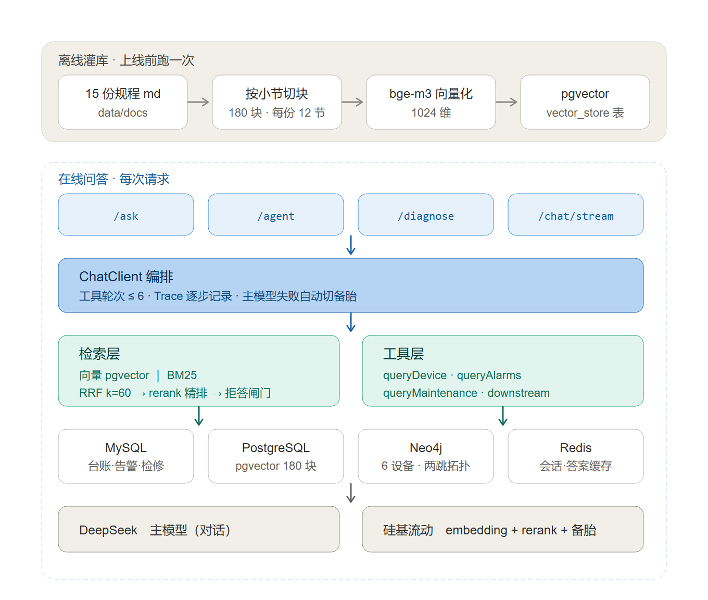

# 电力故障研判助手（power-rag）

电网告警看不懂、规程几百页查不过来——这个模块把「查台账、查告警、查拓扑、查规程」合成一个问答入口：向量 + BM25 双路召回融合重排做规程问答，Tool Calling 查真实台账，Neo4j 查供电拓扑，大模型只负责组织结论，规程里没有的明确说「没有」。

技术栈：Spring Boot 3.3.5 · Spring AI 1.0.0 · Java 21 · pgvector · Neo4j 5 · Redis 7 · MySQL 8 · DeepSeek / 硅基流动。



## 1 这是什么

- **离线灌库**（跑一次）：15 份规程 md → 按小节切块（约 180 块）→ bge-m3 向量化 → pgvector `vector_store` 表。
- **在线问答**（每次请求）：`/ask` 单轮 RAG；`/agent` 多工具研判（台账 + 规程）；`/diagnose` 告警研判（加拓扑，最多 6 步工具，逐步 trace）；`/chat/stream` SSE 流式 + 会话记忆。
- 检索固定链路：向量 top10 + BM25 top10 → RRF(k=60) 融合 → bge-reranker-v2-m3 精排 → 重排分 < 0.5 直接拒答（不调大模型）。
- **前端入口**：登录后任意页面右下角的「电力规程助手」角标，走网关 `/api/rag/**`（StripPrefix=2 转发，鉴权仍由网关 JWT 统一做）。

## 2 快速开始

环境要求：JDK 21；Docker 起三个容器；MySQL 8 本机服务（台账/告警/检修三张表，建库脚本见仓库根 `sql/`）；两个模型 key（DeepSeek 对话 + 硅基流动 embedding/rerank）配在被 gitignore 的 `src/main/resources/application-local.yml`（不入库，换机器把该文件复制过去即可），主 `application.yml` 里只留 `${DEEPSEEK_API_KEY:}` 等占位，没有 local 文件也能起，但调模型会 401。

```bash
# 1. PostgreSQL + pgvector（向量库）
docker run -d --name pgv -p 5432:5432 -e POSTGRES_PASSWORD=postgres pgvector/pgvector:pg16

# 2. Redis（会话记忆 + 答案缓存）
docker run -d --name power-redis -p 6379:6379 redis:7.4-alpine

# 3. Neo4j（供电拓扑，密码要与 application.yml 里一致）
docker run -d --name neo4j -p 7474:7474 -p 7687:7687 -e NEO4J_AUTH=neo4j/<你的密码> neo4j:5
```

数据初始化（三步，缺一个链路就不全）：

1. 向量库：服务启动后 `curl -X POST http://localhost:8088/ingest`（把 `data/docs/` 15 份 md 切块灌入，灌完 `vector_store` 应为 180 行）；
2. Neo4j 拓扑：按 `docs/cypher.md` 里的语句建设备节点与 FEEDS 供电关系；
3. MySQL 台账：`power_device`（设备/变电站/电表）与 `power_alert`（告警/检修）的建库与初始数据见仓库根 README。

启动：IDEA 运行配置选 `power-rag`（或直接选 `全部后端（6 个服务）` 一起起），端口 8088。命令行方式在项目根执行 `./build.sh -pl power-rag -am -DskipTests package`，再 `java -jar power-rag/target/power-rag-2.0.0.jar --server.port=8088`。

## 3 接口

| 接口 | 参数 | 说明 |
| --- | --- | --- |
| GET /ask | q | 单轮 RAG 问答（带答案缓存，TTL 30min） |
| GET /agent | q | 多工具研判：台账 + 告警 + 检修 + 规程检索，返回 trace |
| GET /diagnose | alarm | 告警研判：加 Neo4j 拓扑，工具上限 6 步 |
| GET /chat/stream · /chat/mem | q · (sid, q) | SSE 流式；/chat/mem 带会话记忆 |
| GET /ask-fb | q | 主模型失败自动切备胎的演示 |
| GET /stats · /stats/reset | — | 缓存命中 / token 统计；重置 |
| GET /eval?mode=rrf-rerank | — | 跑 100 题评测（检索 + 拒答） |
| GET /search · /ask2 | question | 调试台：只看检索结果 / 换参数问答 |
| POST /ingest | — | 重新灌库 |

三个真实例子（输出均为 2026-11-11 实跑原文，未删改；Windows 下请在 Git Bash / WSL 里执行——cmd 的 curl 对中文参数按 GBK 编码，服务端会收到乱码）：

```bash
curl "http://localhost:8088/ask?q=油温到多少度算危急缺陷"
# {"answer":"根据资料1，顶层油温达到 95℃ 发危急告警并启动跳闸回路。资料4中三级（橙色，95℃ 及以上）
#  为最高等级处置。资料中未直接使用“危急缺陷”这一表述，但按温度分级，95℃ 及以上对应危急级别。
#  出处：资料1、资料4","sources":["主变过温告警处置","设备过热分级处置","变压器运行规程",...]}

curl "http://localhost:8088/agent?q=天鹰刀断路器现在是什么状态，最近有没有告警"
# trace 2 步：queryDevice(天鹰刀断路器) → queryAlarms(天鹰刀断路器)
# 【结论】天鹰刀断路器（天鹰坛变电站 101 间隔，110kV）当前处于检修中状态……
#         最近告警 1 条：中级别 / 已确认（ACKNOWLEDGED）未闭环 / 设备过热 / 2025-05-20 …（完整输出见 docs/trace-example.json 同格式）

curl "http://localhost:8088/diagnose?alarm=天鹰刀断路器 SF6 压力低告警，气压降至 0.35MPa，请研判影响范围并给出处置建议"
# 4 步工具（queryDevice → queryAlarms → downstream → searchDocs），12.4s
# 【研判结论】SF6 气压下降多为密封圈老化或管路渗漏……【影响范围】天鹰坛 110kV 母线侧……
# 【处置建议】检漏定位 → 按导则抽真空充气……【规程依据】《断路器检修导则》3/4 节
# 完整原文（含逐步 trace）见 docs/diagnose-example.json
```

## 4 效果

评测集 100 题（40 直答 / 30 跨段 / 30 否定），详见 `docs/eval.md`：

| 指标 | 结果 | 测法 |
| --- | --- | --- |
| 检索 Top-3 命中 | 100%（70/70） | 100 题全量，否定题不计入分母 |
| 检索 Top-1 命中 | 97.1%（68/70） | 同上 |
| 答案正确率 | 96.7%（29/30） | 人工抽检 30 条（直答 15 + 跨段 15） |
| 否定类拒答准确 | 100%（30/30） | 30 题全量，重排分 < 0.5 拒答 |
| 平均响应 | 1.61 s（660 token） | 30 条样本；命中缓存后 5–7 ms |

## 5 目录结构

| 包 | 说明 |
| --- | --- |
| controller | 8 个入口：Ask / Agent / Diagnose / ChatStream / Fallback / ToolChat / Eval / Debug（含 /stats 合并展示） |
| retrieval | HybridRetriever（双路 + RRF + 重排 + 拒答闸门）、Bm25Index、Reranker、Rrf |
| tools | DeviceTools（MySQL 台账/告警/检修）、DocTools（规程检索）、GraphTools（Neo4j 上下游两跳） |
| service | AnswerCache（Redis 答案缓存）、ResilientChat（主备降级）、Stats、AskResult |
| memory / trace | 会话记忆 / 工具调用逐步 trace |
| splitter | 按小节切块与切块校验 |
| config | DeviceDbConfig（第二数据源，方法内 new，不注册第二个 DataSource bean）、BackupConfig |

## 6 已知限制

- 语料是 15 份自写模拟规程（约 180 块），结构与真实规程相近，但覆盖面远小于真实资料库；台账 6 台设备、告警 7 条，均为演示数据。
- 拒答阈值 0.5 余量很薄：正例最低 0.516 / 否定最高 0.470，窗口仅 0.046——换 reranker 或换语料必须重跑标定。
- Neo4j 拓扑只支持上下游两跳，且「谁给谁供电」是手工造的关系，不是从台账推导的。
- token 统计只覆盖非流式接口（/ask、/ask-fb）；/chat/stream 的 usage 在流末帧，未聚合。
- 答案正确率由一人按三条硬标准判定，无第二人复核；跨段题在「答得全不全」上有主观余地。
